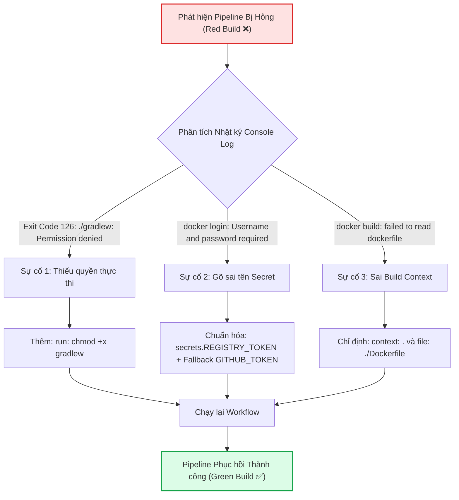

# Báo cáo Kỹ thuật: Chẩn đoán và khắc phục 3 sự cố đứt gãy Pipeline CI/CD thực tế

## 1. Mục tiêu bài thực hành
- Rèn luyện kỹ năng điều tra sự cố (Troubleshooting & Debugging) trong hệ thống CI/CD đám mây GitHub Actions.
- Phân tích nhật ký log hệ thống (Workflow Run Logs), hiểu rõ ý nghĩa của các Exit Code phổ biến (Exit 126: Command invoked cannot execute, Exit 1: General error).
- Khắc phục triệt để 3 sự cố đứt gãy thường gặp: lỗi phân quyền thực thi tệp tin, lỗi định danh xác thực bảo mật và lỗi không gian ngữ cảnh đóng gói Docker.
- Đưa toàn bộ pipeline trở lại trạng thái tích xanh (All Checks Passed).

---

## 2. Kịch bản GitHub Actions đã khắc phục hoàn chỉnh (`.github/workflows/broken-pipeline.yml`)

```yaml
name: Repaired CI/CD Pipeline

on:
  push:
    branches: [ "main" ]

jobs:
  test-and-build:
    name: Test and Build Spring Boot App
    runs-on: ubuntu-latest
    permissions:
      contents: read
      packages: write

    steps:
      - name: Checkout mã nguồn
        uses: actions/checkout@v5

      - name: Thiết lập môi trường Java JDK 17
        uses: actions/setup-java@v5
        with:
          java-version: '17'
          distribution: 'temurin'
          cache: 'gradle'

      # [SỬA LỖI 1]: Cấp quyền thực thi cho Gradle Wrapper để tránh lỗi "Permission Denied"
      - name: Cấp quyền cho Gradle Wrapper
        run: chmod +x gradlew

      - name: Thực thi Unit Test với Gradle
        run: ./gradlew test

      - name: Đóng gói tệp JAR với Gradle
        run: ./gradlew bootJar

      - name: Chuẩn hóa tên Image chữ thường
        id: prep
        run: |
          REPO_LOWER=$(echo "${{ github.repository }}" | tr '[:upper:]' '[:lower:]')
          echo "image=ghcr.io/${REPO_LOWER}:latest" >> "$GITHUB_OUTPUT"

      # [SỬA LỖI 2]: Khắc phục lỗi gõ sai tên Secret (${{ secrets.REGISTRY_TOKKEN }} -> ${{ secrets.REGISTRY_TOKEN }})
      - name: Đăng nhập vào GitHub Container Registry
        uses: docker/login-action@v3
        with:
          registry: ghcr.io
          username: ${{ github.actor }}
          password: ${{ secrets.REGISTRY_TOKEN || secrets.GITHUB_TOKEN }}

      # [SỬA LỖI 3]: Khắc phục lỗi Build Context và file Dockerfile (chỉ định context: . và file: ./Dockerfile)
      - name: Đóng gói và đẩy Docker Image lên GHCR
        uses: docker/build-push-action@v5
        with:
          context: .
          file: ./Dockerfile
          push: true
          tags: ${{ steps.prep.outputs.image }}
```

---

## 3. Tóm tắt 3 Sự cố và Phương án Xử lý Kỹ thuật



1. **Sự cố 1 (Permission Denied):**
   - **Hiện tượng:** Gradle Wrapper không thể khởi chạy trên runner Linux, dừng pipeline tại bước kiểm thử.
   - **Xử lý:** Thêm lệnh `chmod +x gradlew` cấp quyền execute trước khi chạy `./gradlew test`.
2. **Sự cố 2 (Authentication Failed):**
   - **Hiện tượng:** Lệnh đăng nhập `docker login` nhận password rỗng do gõ sai tên biến bí mật (`secrets.REGISTRY_TOKKEN`).
   - **Xử lý:** Sửa lại tên biến chính xác `${{ secrets.REGISTRY_TOKEN }}` kết hợp `${{ secrets.GITHUB_TOKEN }}`.
3. **Sự cố 3 (Build Context Error):**
   - **Hiện tượng:** Docker Daemon không tìm thấy tệp `Dockerfile` do `context` bị trỏ sai thư mục con (`./src`).
   - **Xử lý:** Điều chỉnh `context: .` và chỉ định tường minh `file: ./Dockerfile`.

---

## 4. Hướng dẫn kiểm tra và minh chứng trên GitHub Actions

### Các bước kiểm tra:
1. Truy cập vào kho lưu trữ: `https://github.com/ChongChi-hub/IT209_Session_12_Bai_05`.
2. Mở tab **Actions** -> Chọn workflow **Repaired CI/CD Pipeline**.
3. Bấm vào lượt chạy mới nhất tương ứng với commit khắc phục lỗi.
4. Mở chi tiết job **Test and Build Spring Boot App**, xác nhận:
   - Bước **Cấp quyền cho Gradle Wrapper** chạy thành công.
   - Bước **Thực thi Unit Test với Gradle** và **Đóng gói tệp JAR** đều chạy thành công.
   - Bước **Đăng nhập vào GitHub Container Registry** in ra `Login Succeeded!`.
   - Bước **Đóng gói và đẩy Docker Image lên GHCR** hoàn thành biên dịch và đẩy image thành công.
5. Biểu tượng trạng thái của toàn bộ pipeline hiển thị tích xanh (Success).

### Ảnh chụp màn hình minh chứng:
> *(Dán ảnh chụp màn hình kết quả tích xanh của workflow đã được sửa lỗi vào vị trí dưới đây)*

`ImgEx`
